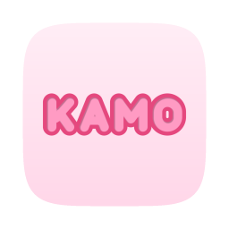

<p align="center">
  
</p>

<h1 align="center">KAMO</h1>

<p align="center">
  <b>Kirby &amp; The Amazing Mirror, native on Windows, macOS and Linux — with online co-op for up to four players.</b>
</p>

<p align="center">
  
  
  
</p>

> [!IMPORTANT]
> KAMO does not include the game. You need your own legally dumped ROM of **Kirby & The Amazing
> Mirror (USA)**. KAMO is an unofficial fan project, not affiliated with, endorsed or sponsored by
> Nintendo or HAL Laboratory. Kirby and all related names are trademarks of their respective owners.

## About

Kirby & The Amazing Mirror was built around four-player co-op, but playing it that way has always
meant four Game Boy Advance systems, four cartridges and link cables. KAMO brings the game to PC
and replaces the link cable with the internet: create a session, invite your friends or open it to
everyone, and explore the Mirror World together.

## Status

KAMO is in early development. There are no releases yet.

| | |
|---|---|
| Single player, from start to finish | ✅ Playable |
| Keyboard and controllers, remapping | ✅ |
| Battery saves, save states, fast forward, rewind | ✅ |
| Link cable between 2–4 consoles | ✅ |
| Online co-op by direct connection (test build: `KAMO-Netplay`) | 🧪 Testing |
| Local multiplayer on one PC | 🔨 In progress |
| Public and private sessions | 📋 Planned |
| Native code through static recompilation ([`recomp/`](recomp/README.md)) | 🧪 Testing |

See the [roadmap](docs/ROADMAP.md) for details.

## Online co-op

The original multiplayer mode is all there in the game: up to four Kirbys exploring the same world,
each with their own camera, calling each other for help. KAMO keeps that mode exactly as designed
and only changes how the consoles talk to each other.

- **Sessions.** Create a session and share its code, or browse public sessions and join one.
  Private sessions can only be joined with the code. Up to four players.
- **Netcode built for the internet.** Sending the link cable signal over the network is what makes
  link play in emulators unreliable. In KAMO, every player's PC runs all four consoles joined by a
  virtual cable, and only button presses travel over the network — a few bytes per frame.
- **Your save is yours.** Each player keeps their own progress, just like each cartridge did.

How it works is described in [docs/MULTIPLAYER.md](docs/MULTIPLAYER.md).

### Trying it now

Download `KAMO-<version>-Windows-x64.zip` from the [latest release](https://github.com/JhonnyEDM/KAMO/releases/latest),
extract it and run `KAMO.exe`. This is the recompiled build (see [`recomp/`](recomp/README.md)); it
needs your own ROM and your own GBA BIOS.

1. Pick your ROM in the launcher. The first time you press **Play**, KAMO asks for the BIOS.
2. Press **Netplay**. One player creates a room (public, or private with a password); the others
   join it from the list. Online rooms hold up to four players; LAN / direct-IP rooms hold two.
3. When everyone is in, the game boots. On every console choose **Start Game > Multi Player**;
   player 1 confirms.

Everyone needs the same KAMO version and the same ROM. Progress from an online session is saved
as a shared session file that you can resume from.

## Getting started

1. Build KAMO (see [Building](#building)) or download a release once available.
2. Open KAMO and click **Choose ROM...** to pick your dump. Only the USA release (game code
   `B8KE`, revision 0) is supported. KAMO verifies the file and only remembers where it is; it
   never copies, uploads or changes it.
3. Press **Play**. Next time, **Continue** picks up where you left off.

No BIOS is needed.

## Controls

| GBA | Keyboard | Controller |
|---|---|---|
| D-pad | Arrow keys | D-pad or left stick |
| A | X | A (bottom) or Y (top) face button |
| B | Z | B (right) or X (left) face button |
| L / R | A / S | Shoulder buttons or triggers |
| Start | Enter | Start |
| Select | Backspace or Right Shift | Back |

| Shortcut | Keyboard | Controller |
|---|---|---|
| Settings menu | F1 or Esc | |
| Fullscreen | F11 | |
| Save state / load state | Page Up / Page Down | Back + R / Back + L |
| Fast forward (hold) | Tab | Right stick click |
| Rewind (hold) | ` (backtick) | Left stick click |

Everything except F1, Esc and F11 can be rebound in **F1 > Controls**.

## Saves

Saves, save states and settings live in your user folder:

- **Windows:** `%APPDATA%\KAMO\KAMO\`
- **macOS:** `~/Library/Application Support/KAMO/KAMO/`
- **Linux:** `~/.local/share/KAMO/KAMO/`

**Portable mode:** put an empty file named `portable.txt` next to KAMO, and everything is kept in a
`userdata` folder beside it.

## Building

You need CMake 3.24 or newer and a C++20 compiler. SDL3, Dear ImGui and the other libraries are
downloaded during configure.

**Windows** (Visual Studio 2022 or its Build Tools with the C++ workload, plus Ninja):

```powershell
.\build.ps1
.\build\KAMO.exe
```

**macOS / Linux:**

```sh
cmake -S . -B build -DCMAKE_BUILD_TYPE=Release
cmake --build build
./build/kamo
```

On Linux, install SDL3's usual build dependencies first (see `.github/workflows/build.yml`).

## Project layout

| Path | Contents |
|---|---|
| `src/gba` | Game Boy Advance runtime: CPU, graphics, sound, BIOS calls and the virtual link cable |
| `src/app`, `src/options` | Launcher, settings menu, input, saves and states |
| `src/update` | Automatic updates from GitHub Releases |
| `recomp/` | Recompiled build on GBARecomp: game host, game configuration, test tools |
| `tools/` | Developer tools: icon renderer, code tracer, headless link-cable runner |
| `tests/` | Automated tests |
| `docs/` | Architecture, multiplayer design and roadmap |

## Contributing

Bug reports and pull requests are welcome; see [CONTRIBUTING.md](CONTRIBUTING.md). Keep game content out of the repository: no ROMs, BIOS
files, saves, save states, extracted assets, code generated from the ROM, or screenshots of the game.

## Credits

- KAMO is built on [KNID](https://github.com/sweatyeggs69/KNID), the native PC port of
  *Kirby: Nightmare in Dream Land* by sweatyeggs69, used under the MIT License. Its GBA runtime,
  launcher and packaging are the foundation KAMO started from.
- The recompiled build (`recomp/`) runs on [GBARecomp](https://github.com/mstan/gbarecomp) by
  Matthew Stanley, used under the PolyForm Noncommercial License 1.0.0, with its components
  [arm-recomp-core](https://github.com/mstan/arm-recomp-core),
  [recomp-net](https://github.com/RetroPortingToolKit/recomp-net) and
  [rbengine](https://github.com/RetroPortingToolKit/rbengine) (MIT), and its launcher and
  online lobby [recomp-ui](https://github.com/mstan/recomp-ui) (MIT).
- [SDL](https://libsdl.org), [ENet](https://github.com/lsalzman/enet), [Dear ImGui](https://github.com/ocornut/imgui),
  [stb](https://github.com/nothings/stb), [rcheevos](https://github.com/RetroAchievements/rcheevos),
  [DM Sans](https://github.com/googlefonts/dm-fonts) and [Lucide](https://lucide.dev).

Full license texts are in [THIRD_PARTY_NOTICES.md](THIRD_PARTY_NOTICES.md).

## License

KAMO is released under the [MIT License](LICENSE). Builds of the recompiled version include
GBARecomp and are therefore limited to noncommercial use (see
[THIRD_PARTY_NOTICES.md](THIRD_PARTY_NOTICES.md)).
